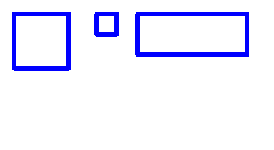
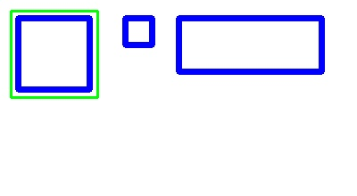
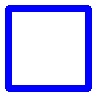

# PyCode

Small Python experiments by Ramtin. The reproducible example here covers two image scripts: a vertical half split and a detector for roughly square blue-bordered regions. This is a utility collection, not a general image-segmentation package.

## Before and after

Synthetic input, actual annotated output and the single accepted crop:





The large square is accepted. The small square and wide rectangle are rejected. Output is 97 × 97 pixels, including padding; the source fixture is 400 × 220.

## Setup and commands

Verification used Python 3.13.16 on Windows and the three pinned packages in [requirements.txt](SplitingImages/requirements.txt).

```bash
git clone https://github.com/boyInShadows/PyCode.git
cd PyCode
python -m venv .venv
```

Activate with `.venv\Scripts\Activate.ps1` in PowerShell, or `source .venv/bin/activate` in a POSIX shell, then:

```bash
python -m pip install -r SplitingImages/requirements.txt
python -m unittest discover -s tests -v
```

For your own image, create `splitingImages/images` from the repository root and place a JPEG named `sucket.jpg` there. **The lowercase data-directory spelling is intentional:** the current scripts hardcode it, separately from the tracked `SplitingImages` source folder. Run from the repository root:

```bash
python SplitingImages/split_image.py
python SplitingImages/split_square_images.py
```

Both write to `splitingImages/images/output/`. The first saves `left_half.jpg` and `right_half.jpg`; an odd width gives the extra column to the right. It runs on import and raises if the fixed input cannot be opened. The detector prints an error and returns for unreadable input, writes `image_N.jpg` crops and `detected_boxes.jpg`, and can skip numbers because filenames use contour indices.

## Detector constraints

[detect_and_split_images](SplitingImages/split_square_images.py) thresholds OpenCV HSV blue values from `(100,100,100)` through `(130,255,255)`. It accepts bounding boxes at least 50 pixels in both dimensions with width/height between 0.8 and 1.2, adds five-pixel padding and clamps to image bounds. It does not detect arbitrary rectangular photos, arbitrary border colors or semantic objects.

Outputs are JPEGs and may overwrite previous same-named results. Old crops are not cleared, so use a fresh output directory for each input. No command-line path arguments or write-success checks are implemented. Three offline tests verify odd-width dimensions, size/aspect rejection and missing-input behavior; no cross-platform or broad image corpus evaluation was run.

## Other experiments

- [Timer](Timer/timer_app.py): a Tkinter countdown experiment; desktop interaction and thread safety were not validated in this pass.
- [TradingBot](TradingBot/bot.py): a separate Flask/market-data experiment with its own requirements and logs. It is outside this example's install and verification. No trading session, exchange request or performance claim was tested. The [quantumSector](https://github.com/boyInShadows/quantumSector) frontend has matching `/backtest` and `/live` endpoint names; integration was not verified.

The existing `master` default branch and scripts are preserved. This pass adds documentation, isolated tests and pinned image-tool dependencies; it does not certify the unrelated experiments.
